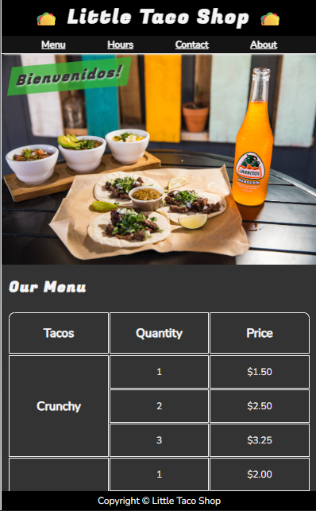
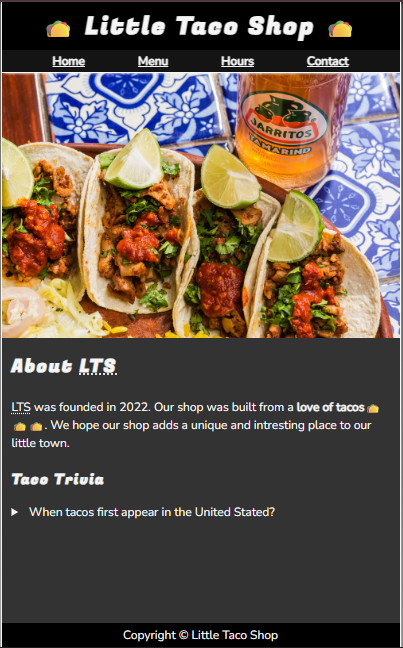
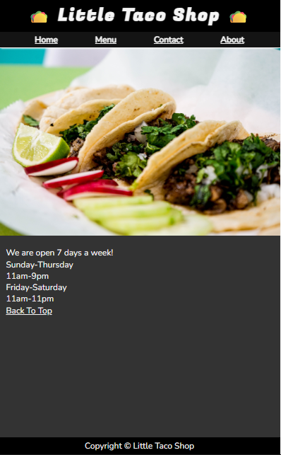
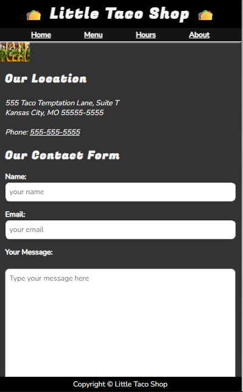

# Little Taco Shop 🌮

A responsive multi-page website for Little Taco Shop, built using HTML5 and CSS3. The website presents the shop's menu, opening hours, location, and contact form.

## Features

- **Home Page:** Introduction to Little Taco Shop and its menu.
- **About Page:** Information about the shop and Taco Trivia.
- **Menu Page:** Displays taco items and prices in a table.
- **Hours Page:** Shows the shop's opening hours.
- **Contact Page:** Provides location details and a contact form.
- **Responsive Design:** CSS styling adapts the website to different screen sizes.
- **Dark Mode Support:** Includes styles for the user's preferred color scheme.

## Technologies Used

- HTML5
- CSS3
- Google Fonts

## Screenshots

### Menu Page


### About Page


### Opening Hours Page


### Contact Page


## Project Structure

```text
HTML-CSS-Project/
├── index.html
├── about.html
├── hours.html
├── contact.html
├── style.css
├── img/
└── screenshots/
    ├── menu.png
    ├── about.png
    ├── hours.png
    └── contact.png
```

## How to Run

1. Clone or download this repository.
2. Open the `HTML-CSS-Project` folder.
3. Open `index.html` in your browser, or use the VS Code Live Server extension.

## Author

Madan S K